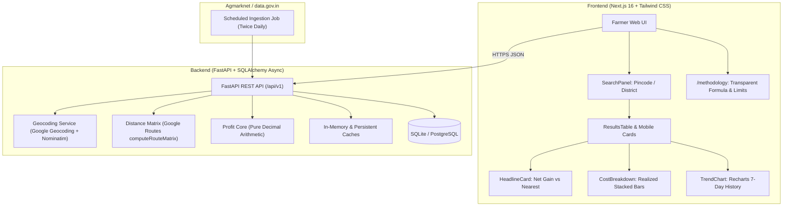

# Mandi Arbitrage Advisor (मंडी आर्बिट्राज सलाहकार)

A high-performance, farmer-centric decision intelligence tool that calculates the **true net realization** per quintal across the 5 nearest APMC mandis after factoring in road freight, vehicle capacity, APMC market cess, commission agent charges, and produce quality discounts.

---

## 1. Overview & Problem Statement

**The Problem**: In India, farmers often transport their produce to the nearest APMC (Agricultural Produce Market Committee) mandi, assuming distance minimization maximizes profit. However, neighboring mandis often offer higher modal prices that more than offset additional transportation costs. Conversely, farmers may travel to distant markets attracted by high headline prices, only to find that freight charges, vehicle under-utilization, market cess, and quality deductions wipe out the margin. Existing platforms (eNAM, Agmarknet) only display gross arrival prices without freight calculations.

**The Solution**: Mandi Arbitrage Advisor bridges this gap. By entering an origin pincode (or state/district), commodity, quantity, vehicle, and produce quality grade, the advisor:
1. Resolves coordinates and discovers candidate mandis within a 150 km radius.
2. Retrieves latest commodity modal prices from local historical snapshots.
3. Batches driving distances via the Google Routes API (`computeRouteMatrix`) with Haversine fallback.
4. Computes true net realization per quintal using strict `Decimal` financial arithmetic.
5. Ranks mandis, computes net profit delta vs. the nearest mandi, and visualizes a 7-day price trend.

---

## 2. Architecture



---

## 3. The Net Profit Formula

All calculations use Python `Decimal` (never floating-point) and are rounded strictly at the output boundary:

```
price_q            = Latest mandi modal price (Rs/quintal, within 3 days)
quality_cut_q      = price_q * (quality_cut_pct / 100)
realized_q         = price_q - quality_cut_q
mandi_fee_q        = realized_q * ((market_fee_pct + commission_pct) / 100)
vehicles_needed    = ceil(quantity_q / vehicle.capacity_q)
transport_total    = vehicles_needed * vehicle.rate_per_km * road_km * round_trip_factor
transport_q        = transport_total / quantity_q
other_q            = (loading_unloading_q + weighing_q) if include_other_charges else 0

net_q              = realized_q - mandi_fee_q - transport_q - other_q
net_total          = net_q * quantity_q
delta_vs_nearest_q = net_q(mandi) - net_q(nearest_mandi)
```

- **Ranking**: Sorted by `net_q` descending, with tie-breaking on smaller `road_km`.
- **Defaults**: Round-trip factor = `1.0`, Other charges = disabled, Quantity = `10 quintals`.

---

## 4. Key Features

- **Liquid Glass Tactile Interface**: iOS 26-inspired "Liquid Glass" design system using translucent panels (`backdrop-filter: blur(24px)`), organic particle background, and high-contrast typography (Fraunces serif headings, Hanken Grotesk body).
- **Zero Forbidden Hues**: Strict palette guard avoiding generic blues and purple gradients; uses earthy tones (Forest green, Wheat gold, Clay terracotta, and Soil brown).
- **Complete Bilingual Support**: Full English (`EN`) and Hindi (`हिं`) localization with Indian numbering (`₹1,23,456.78`).
- **Resilient Fallback Chains**:
  - Pincode Geocoding: Google Geocoding -> OSM Nominatim -> clean 422 error.
  - Road Distance: Google Routes API -> Haversine x 1.3 road factor fallback.
- **Offline Mandi Registry**: 193 verified APMC mandis in Maharashtra with boundary verification.
- **Transparent Assumptions**: User can inspect and override fee %, commission %, and freight rates with inline badge linking to `/methodology`.

---

## 5. Quick Start (PowerShell on Windows)

### Prerequisites
- **Python 3.11+**
- **Node.js 18.18+ (Node 20+ recommended)**
- **PowerShell 5.1 / 7+**

### 1. Clone & Setup Backend
```powershell
# Navigate to backend directory
cd backend

# Create and activate Python virtual environment
py -3 -m venv .venv
.\.venv\Scripts\Activate.ps1

# Install pinned dependencies
pip install -r requirements.txt

# Create .env from template
Copy-Item .env.example .env
# Edit .env with your DATA_GOV_API_KEY and GOOGLE_MAPS_API_KEY

# Run database migrations
alembic upgrade head

# Seed the 193 verified mandis
python scripts/load_mandis_seed.py

# Seed demo historical price series (development mode)
python scripts/seed_demo_history.py

# Start backend server
python -m uvicorn app.main:app --host 127.0.0.1 --port 8000
```

### 2. Setup Frontend
```powershell
# In a second PowerShell terminal, navigate to frontend directory
cd frontend

# Install npm dependencies
npm install

# Create environment file
Copy-Item .env.example .env.local

# Start frontend development server
npm run dev
```

Open `http://localhost:3000` to interact with the advisor.

---

## 6. Testing, Validation & Benchmarks

### Backend Test Suite
```powershell
cd backend
.\.venv\Scripts\pytest -v
```
Runs 18+ comprehensive unit, integration, and pricing formula tests.

### Frontend Test Suite & Design Guards
```powershell
cd frontend
# Run unit & component tests (jsdom + React Testing Library)
npm test

# Run TypeScript type check
npm run typecheck

# Run ESLint
npm run lint

# Run WCAG contrast audit & forbidden color hue scanner
npm run check:design

# Run production build
npm run build
```

### Accuracy Validation Engine
```powershell
# Self-check synthetic evaluation against 10 real agricultural scenarios
python backend/scripts/validate_accuracy.py --self-check
```

### Performance & Latency Benchmark
```powershell
# Benchmark 5 warm queries and 1 cold query against the running API
python backend/scripts/benchmark.py --base-url http://127.0.0.1:8000/api/v1
```
*Latency Target*: Warm P95 < 800 ms, Cold < 3000 ms.

---

## 7. Production Deployment

The project is architected for zero-friction cloud deployment:
- **Backend API**: Deployed to [Railway](https://railway.app) via `Procfile` / `railway.json` with managed PostgreSQL and healthcheck at `/api/v1/health`.
- **Frontend App**: Deployed to [Vercel](https://vercel.com) with root directory set to `frontend`.
- For complete step-by-step instructions, see [`docs/DEPLOY.md`](docs/DEPLOY.md).

---

## 8. Data Sources & Licences

| Source | Provider | License / Terms | Usage |
|---|---|---|---|
| **Agmarknet Mandi Prices** | Ministry of Agriculture & Farmers Welfare, Govt of India via [data.gov.in](https://data.gov.in) | National Data Sharing and Accessibility Policy (NDSAP) | Daily commodity arrival modal prices |
| **Google Geocoding & Routes API** | Google Cloud Platform | Google Maps Platform Terms of Service | Coordinates resolution & driving distance matrix |
| **Nominatim / OpenStreetMap** | OpenStreetMap Foundation | Open Database License (ODbL) | Secondary geocoding fallback |

---

## 9. Honest Assumptions & Limitations

1. **Modal Price is Indicative**: Daily modal price represents the most common transaction price at auction; actual auction lot prices depend on moisture, grain size, and physical inspection.
2. **Statutory APMC Fee Assumptions**: Default 1.0% market fee and 2.0% commission agent cess are standard statutory baselines marked with `ASSUMPTION_UNVERIFIED`. Actual rates vary by state act and trade contract. Farmers can override these in the Advanced panel.
3. **Freight Rate Assumptions**: Freight vehicle rates (Tempo: ₹14/km, Pickup: ₹18/km, Mini-truck: ₹26/km, Truck: ₹38/km) are regional averages without deadhead return charges.
4. **Distance Fallback**: In the event of Google Routes API quota limits or network partitions, the engine falls back to `Haversine * 1.3` road factor and flags the response with `DISTANCE_FALLBACK`.
5. **Seeded Trend History**: Until a full week of daily live Agmarknet snapshots is accumulated, earlier trend dates are simulated and clearly marked with `is_seeded: true` and dashed chart lines.

---

## 10. Repository Layout

```
mandi-arbitrage/
├── backend/
│   ├── alembic/              # Database schema migration versions
│   ├── app/
│   │   ├── api/v1/           # Endpoints: compare, trend, meta, admin
│   │   ├── core/             # Pure math: profit.py, ranking.py, geo.py
│   │   ├── services/         # datagov.py, geocode.py, distance.py, mandis.py
│   │   ├── config/           # rates.json, crops.json
│   │   ├── config.py         # Pydantic v2 application settings
│   │   ├── db.py             # SQLAlchemy async engine & sessionmaker
│   │   ├── models.py         # Mandi, Price, GeocodeCache, DistanceCache
│   │   └── schemas.py        # Pydantic request & response models
│   ├── data/                 # mandis.seed.json, validation/scenarios.csv
│   ├── scripts/              # benchmark.py, validate_accuracy.py, ingest_prices.py
│   ├── requirements.txt      # Pinned Python dependencies
│   ├── Procfile              # Railway deployment start command
│   └── railway.json          # Railway configuration & healthcheck
├── frontend/
│   ├── app/                  # Next.js App Router (layout.tsx, page.tsx, methodology/)
│   ├── components/           # SearchPanel, ResultsTable, HeadlineCard, TrendChart, etc.
│   ├── lib/                  # api.ts, format.ts, i18n.ts, particles-core.ts
│   ├── locales/              # en.json, hi.json (100% key parity)
│   ├── scripts/              # check-contrast.mjs, check-palette.mjs
│   └── package.json          # Pinned Next.js 16 frontend dependencies
├── docs/
│   ├── PROJECT_CONTEXT.md    # Master specifications & hard rules
│   ├── DECISIONS.md          # Architectural decision records
│   ├── API.md                # REST API reference documentation
│   ├── METHODOLOGY.md        # Profit calculation formulation
│   ├── VALIDATION.md         # 10-scenario accuracy report
│   ├── DEPLOY.md             # Click-by-click production deployment guide
│   └── openapi.json          # Exported OpenAPI 3.1.0 schema specification
└── README.md                 # Complete project documentation
```
