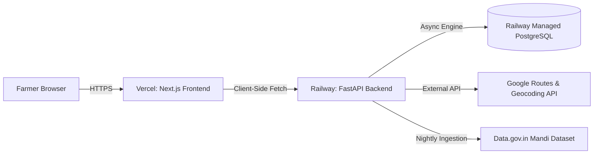

# Production Deployment Guide: Railway (Backend) & Vercel (Frontend)

This guide provides step-by-step instructions for deploying the **Mandi Arbitrage Advisor** production stack:
- **Backend API**: FastAPI + SQLAlchemy (Async) on [Railway](https://railway.app) with managed PostgreSQL.
- **Frontend App**: Next.js 16 + Tailwind CSS on [Vercel](https://vercel.com).

---

## 1. Architecture & Pre-Requisites

### Cloud Architecture


### Pre-Requisites
1. A GitHub repository containing this codebase.
2. An active [Railway](https://railway.app) account.
3. An active [Vercel](https://vercel.com) account.
4. API Keys:
   - `DATA_GOV_API_KEY`: API key from [data.gov.in](https://data.gov.in).
   - `GOOGLE_MAPS_API_KEY`: Google Cloud Platform API key with **Geocoding API** and **Routes API** enabled.
   - `ADMIN_TOKEN`: A secure random token for triggering administrative operations (e.g. `openssl rand -hex 24`).

---

## 2. Backend Deployment: Railway

### Step 2.1: Create Project & Provision PostgreSQL
1. Log in to [Railway](https://railway.app) and click **"New Project"**.
2. Select **"Provision PostgreSQL"**.
3. Once the database is provisioned, click on the Postgres card:
   - Navigate to the **Variables** tab.
   - Railway exposes `DATABASE_URL` in the standard format `postgres://...`.
   - *Note*: Our backend automatically converts `postgres://` or `postgresql://` into `postgresql+asyncpg://` via `app.db.resolve_db_url()`. No manual URL rewriting is necessary!

### Step 2.2: Deploy Backend Service from GitHub
1. In the same project, click **"+ New"** -> **"GitHub Repo"** and select your repository.
2. Click on the newly created service card and navigate to **Settings**:
   - **Service Name**: `mandi-backend` (or your preferred name).
   - **Root Directory**: `backend` (or leave as `/` if using repository root; `railway.json` and `Procfile` are located in `backend/`).
3. Set **Start Command** (if not detected from `railway.json`):
   ```bash
   alembic upgrade head && uvicorn app.main:app --host 0.0.0.0 --port $PORT
   ```
4. Configure **Healthcheck**:
   - **Healthcheck Path**: `/api/v1/health`
   - **Healthcheck Timeout**: `100` seconds (to accommodate cold starts and migrations).

### Step 2.3: Configure Backend Environment Variables
Navigate to the **Variables** tab of the backend service and add:

| Variable Name | Example / Production Value | Notes |
|---|---|---|
| `ENV` | `production` | Enables production security and error handling |
| `DATABASE_URL` | `${{Postgres.DATABASE_URL}}` | Reference to Railway Postgres variable |
| `DATA_GOV_API_KEY` | `579b464db6...` | data.gov.in API key |
| `DATAGOV_RESOURCE_ID` | `9ef84268-d588-465a-a308-a864a43d0070` | Standard Agmarknet commodity resource ID |
| `GOOGLE_MAPS_API_KEY` | `AIzaSy...` | GCP key with Geocoding and Routes API enabled |
| `ADMIN_TOKEN` | `mandi_prod_secret_token_2026` | Used in `X-Admin-Token` header for /admin endpoints |
| `FRONTEND_ORIGIN` | `https://mandi-arbitrage.vercel.app` | **CRITICAL**: Set to your production Vercel URL (no trailing slash) |
| `MAX_RADIUS_KM` | `150` | Search radius around origin |
| `PRICE_MAX_AGE_DAYS` | `3` | Maximum age of prices before flagged as stale |
| `TREND_DAYS` | `7` | Historical snapshot window |

### Step 2.4: Seed the Production Mandi Registry
Once the service builds and boots, the schema migrations will have executed (`alembic upgrade head`). You now populate the production DB with the geocoded mandi registry:
1. In Railway, click the backend service -> **Deployments** -> open the latest deployment.
2. Open the **Terminal** tab or run via the Railway CLI locally:
   ```bash
   railway run python scripts/load_mandis_seed.py
   ```
   *(This loads all 193 geocoded Maharashtra mandis idempotently from `data/mandis.seed.json`).*

---

## 3. Data Ingestion & Cron Configuration

Agmarknet updates market arrivals twice daily. Configure automated ingestion jobs to keep the database fresh:

### Ingestion Schedules (UTC)
1. **Morning Ingestion (05:00 UTC / 10:30 AM IST)**: Captures early morning market arrivals.
2. **Afternoon Ingestion (13:30 UTC / 07:00 PM IST)**: Captures closing daily modal prices.

### Execution Options

#### Option A: External Cron Webhook (Recommended)
Use a free cron service (e.g. [cron-job.org](https://cron-job.org) or GitHub Actions) to send an authenticated HTTP POST request:
```bash
curl -X POST "https://<your-railway-url>.up.railway.app/api/v1/admin/ingest" \
     -H "X-Admin-Token: <ADMIN_TOKEN>"
```

#### Option B: GitHub Actions Scheduled Workflow
Create `.github/workflows/ingest.yml`:
```yaml
name: Mandi Daily Ingestion
on:
  schedule:
    - cron: '0 5 * * *'    # 05:00 UTC
    - cron: '30 13 * * *'   # 13:30 UTC
  workflow_dispatch:

jobs:
  ingest:
    runs-on: ubuntu-latest
    steps:
      - name: Trigger Mandi Ingestion
        run: |
          curl -s -X POST "${{ secrets.RAILWAY_API_URL }}/api/v1/admin/ingest" \
               -H "X-Admin-Token: ${{ secrets.ADMIN_TOKEN }}" \
               -w "\nHTTP Status: %{http_code}\n"
```

---

## 4. Frontend Deployment: Vercel

### Step 4.1: Import Repository
1. Log in to [Vercel](https://vercel.com) and click **"Add New..."** -> **"Project"**.
2. Select your GitHub repository.

### Step 4.2: Configure Build & Root Directory
- **Framework Preset**: `Next.js`
- **Root Directory**: `frontend` *(Click "Edit" and type `frontend`)*
- **Build Command**: `npm run build` (default)
- **Output Directory**: `.next` (default)

### Step 4.3: Environment Variables
Add the following environment variable in the Vercel project configuration:

| Variable Name | Value | Purpose |
|---|---|---|
| `NEXT_PUBLIC_API_BASE_URL` | `https://<your-railway-url>.up.railway.app/api/v1` | Public API URL accessible by the browser |

### Step 4.4: Deploy & Synchronize CORS
1. Click **"Deploy"**. Vercel will build and assign a domain (e.g., `https://mandi-arbitrage.vercel.app`).
2. **Important CORS Step**: Return to Railway, navigate to the backend service variables, and ensure:
   ```
   FRONTEND_ORIGIN=https://mandi-arbitrage.vercel.app
   ```
   *(Ensure no trailing slash). Railway will automatically redeploy the backend with the new allowed origin.*

---

## 5. Cold-Start Mitigation (Railway Free/Hobby Tier)

On Railway free/hobby tiers, idle containers sleep after inactivity. Spinning back up typically takes 10 to 15 seconds.
1. **In-App Handling**: The frontend automatically displays a gentle notice if a query takes longer than 4.0 seconds:
   *"Backend is waking up — free-tier instances take ~15 seconds to spin up. Hang tight!"*
2. **Synthetic Keep-Alive (Optional)**:
   Configure a periodic ping (every 10 minutes) to `GET https://<your-railway-url>/api/v1/health` using [UptimeRobot](https://uptimerobot.com) to prevent the container from sleeping during daytime market hours.

---

## 6. Live Verification & Benchmark

### 6.1: Verify Health
```bash
curl -i https://<your-railway-url>.up.railway.app/api/v1/health
```
*Expected*: HTTP 200 with `{"status":"ok","version":"1.00.00",...}`.

### 6.2: Verify Compare Endpoint
```bash
curl -i -X POST https://<your-railway-url>.up.railway.app/api/v1/compare \
  -H "Content-Type: application/json" \
  -d '{
    "pincode": "440001",
    "commodity": "Wheat",
    "quantity_quintals": 10,
    "vehicle": "tempo",
    "quality": {"grade": "Good"},
    "price_basis": "modal",
    "include_other_charges": false,
    "limit": 5
  }'
```
*Expected*: HTTP 200 with JSON payload containing 5 ranked mandis, `breakdown`, `summary`, and `X-Process-Time-ms` header.

### 6.3: Run Performance Benchmark Against Live Backend
From your local terminal, run the benchmark script directly against the deployed Railway URL:
```powershell
python backend/scripts/benchmark.py --base-url https://<your-railway-url>.up.railway.app/api/v1
```
*Expected*: Latency report confirming warm p95 < 800 ms and cold < 3000 ms.
